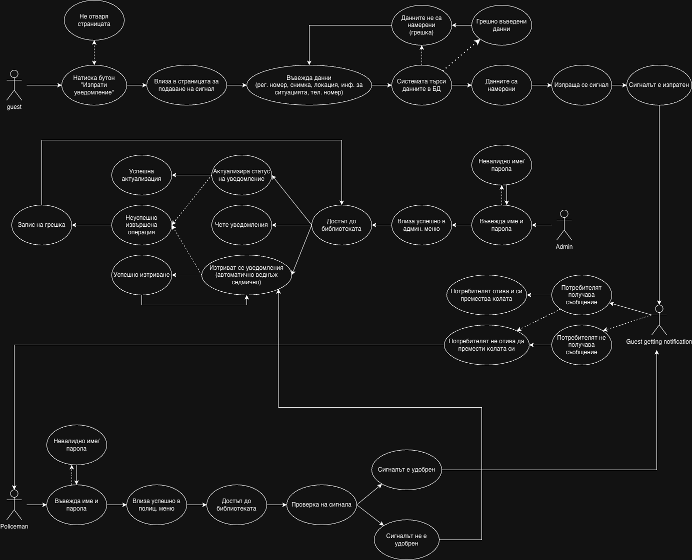

# **Документация на проект - Better Parking**

## **Информация за екипа**

**Име на екипа:**
_CTRL-ALT-DEFEAT_

**Членове на екипа:**

- Кристиан Георгиев - Програмист
- Георги Хараланов - Програмист, Дизайнер
- Мартин Найденов - Дизайнер
- Радостина Русчева - Business Dev
- Мартин Смиленов - Business Dev

**Училище/клас:**
ПМГ "К. Величков" 12д

---

## **Описание на проекта**

Представяме среда, в която отношението е стандарт: когато някой бъде блокиран, ние посрещаме проблемите му моментално. Уеб-приложението превръща всяка евентуална конфликтна ситуация в диалог – създаваме платформа за подаване на сигнали. Сигналът се въвежда за секунди, автоматично се изпраща имейл (в бъдеще и SMS) до собственика на задръстващия автомобил и така контактът остава уважителен. Това е град, в който технологичният прогрес се измерва в отношението между хората.

### **Какво прави проектът?**

Страницата за подаване на сигнал позволява качване на снимка, добавяне на GPS координати и контакт чрез имейл или телефон – без изтегляния и без регистрации.
Облакът (Cloudflare R2) пази данните на потребителите, backend-ът следи всеки сигнал в реално време.
Административният панел отваря библиотека с детайли на всеки случай, за да може органите на реда да реагират при нужда.

### **Проблем, който решаваме**

Когато вмъкнем тази система в текущата градска инфраструктура, получаваме автоматизирана карта на конфликтните точки, аргументи за реорганизация на трафика и доказателство, че ще подкрепите по-добър град.
Избирайки „BetterParking“, придобивате готово SaaS решение с пътни карти и push известия.

## **Технологии**

### **Използвани технологии и инструменти**

- **Програмни езици: JavaScript**
- **Frameworks/библиотеки: Express, EJS**
- **Бази данни: SQLITE, Drizzle ORM**
- **Други: Nodemailer, Amazon S3, Cloudflare R2**

---

## **Функционалности**

### **Основни функции**

1. Доквадване на автомобил
2. Изпращане на имейл (TODO: SMS) до собственика на автомобила
3. Прикачване на снимка и локация в оплакването

### **Допълнителни функции (ако има)**

- Преглед на опаквания от админ
- Изтриване на оплаквания от админ

#### Бизнес кейс

## **Как работи?**

### **Архитектура**

- Front-End апликация с подобаващ UI/UX
- Back-End апликация, отговаряща за бизнес логиката и говореща с Базата Данни
- DB съхраняващ данни
  

---

## **Инсталация и стартиране**

### **Изисквания**

- Node.js
- Git

## **_Какво трябва да е инсталирано предварително?_**

### **Стъпки за стартиране**

- clone [project](https://github.com/kradeca4287/Hackathon)
- run `npm install`
- add `.env` variable example .env can be seen in `.env.example`
- run `npm run generate-migration`
- run `npm run migrate`
- run `npm run dev`

## **\[Линк към скрийн рекорд с демо\]**

## [Video](./Screen%20Recording%202025-11-16%20at%2013.55.39.mov)

## **Предизвикателства и решения**

### **Какви трудности срещнахме?**

- **Предизвикателство 1:**

  - Setup на проекта - структура на файлове, избор на технологии и коректност на версиите

- **Предизвикателство 2:**

  - Проблем със сетъп на първоизбрания ORM - Prisma

- **Предизвикателство 3:**

  - Оправяне на routing-a

- **Предизвикателство 4:**

  - Връзката между FE и BE

- **Предизвикателство 5:**
  - Халюцинации от AI

---

## **Бъдещо развитие**

### **Какво бихме добавили с повече време?**

- SMS система
- Интерактивна карта
- Изобразяване на снимките в имейла и админ панела
